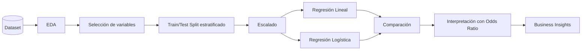
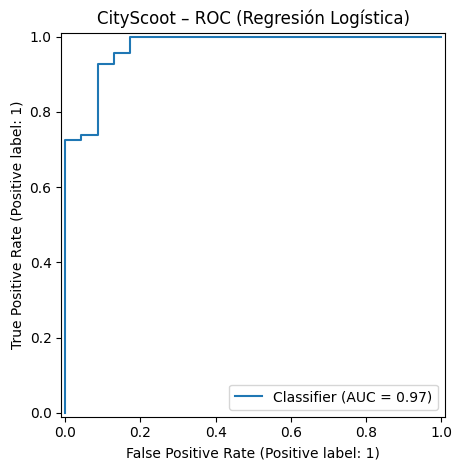
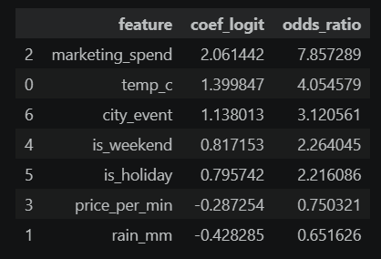

<p align="center">
  
</p>

# 🛴 CityScoot – Clasificación de la demanda mediante regresión logística

> **Pipeline de Machine Learning para clasificar la demanda diaria de scooters y demostrar cómo la correcta elección del modelo depende del objetivo de negocio.**

<br>

<p align="center">

📅 **Dataset:** 365 días &nbsp;&nbsp;&nbsp;|&nbsp;&nbsp;&nbsp;
🎯 **Problema:** Clasificación binaria &nbsp;&nbsp;&nbsp;|&nbsp;&nbsp;&nbsp;
📈 **Modelo:** Logistic Regression &nbsp;&nbsp;&nbsp;|&nbsp;&nbsp;&nbsp;
📊 **ROC-AUC:** 0.97 &nbsp;&nbsp;&nbsp;|&nbsp;&nbsp;&nbsp;
🛴 **Caso de uso:** Micromovilidad urbana

</p>

<p>


</p>

---

# 📑 Tabla de contenidos

- [Caso de negocio](#-caso-de-negocio)
- [Objetivo](#-objetivo)
- [Dataset](#-dataset)
- [Estructura del repositorio](#-estructura-del-repositorio)
- [Cómo ejecutar](#-cómo-ejecutar)
- [Metodología](#-metodología)
- [Resultados](#-resultados)
- [Visualizaciones](#-visualizaciones)
- [Impacto en el negocio](#-impacto-en-el-negocio)
- [Competencias demostradas](#-competencias-demostradas)
- [Autora](#-autora)

---

# 💼 Caso de negocio

CityScoot es una empresa de micromovilidad urbana que busca **anticipar la demanda diaria de scooters** para optimizar la asignación de flota, la estrategia de precios y la planificación operativa.

Inicialmente el problema fue planteado como una tarea de **regresión**, cuyo objetivo era estimar el número exacto de viajes diarios. Sin embargo, al redefinir el objetivo de negocio, el enfoque evolucionó hacia un problema de **clasificación binaria**: identificar si un día presentará **alta** o **baja demanda**.

Este proyecto demuestra que la selección del modelo debe responder al problema de negocio y no únicamente a la naturaleza de los datos.

---

# 🎯 Objetivo

Clasificar cada día como 🔴 **alta demanda** (más de 1200 viajes) o 🔵 **baja demanda** (1200 viajes o menos) para anticipar decisiones de distribución de scooters y planificación comercial.

---

# 📂 Dataset

`Data/cityscoot_dataset.csv`: 365 registros diarios (un año de operación).

| Variable | Descripción |
|---|---|
| `temp_c` | Temperatura (°C) |
| `rain_mm` | Precipitaciones (mm) |
| `marketing_spend` | Inversión en marketing |
| `price_per_min` | Precio por minuto |
| `is_weekend` | Fin de semana (0/1) |
| `is_holiday` | Feriado (0/1) |
| `city_event` | Evento urbano (0/1) |
| `demand` | Cantidad de viajes del día |
| **`high_demand`** | **Variable objetivo:** 1 si `demand` > 1200 |

El 75% de los días son de alta demanda, por lo que las clases están desbalanceadas.

---

# 🗂 Estructura del repositorio

```
Cityscoot-logistic-regression/
├── Data/
│   └── cityscoot_dataset.csv                   # Dataset
├── Notebooks/
│   └── CityScoot_LogisticRegression.ipynb      # Pipeline completo
├── images/                                     # Banner y visualizaciones
├── requirements.txt
└── README.md
```

---

# 🧪 Cómo ejecutar

```bash
git clone https://github.com/VaninaCavallin/Cityscoot-logistic-regression.git
cd Cityscoot-logistic-regression
pip install -r requirements.txt
jupyter notebook
```

Abrir `Notebooks/CityScoot_LogisticRegression.ipynb`. El notebook lee el dataset desde `../Data/cityscoot_dataset.csv`.

---

# 🔄 Metodología



1. **Preparación:** selección de las 7 variables predictoras, división train/test (75/25, estratificada) y escalado con `StandardScaler`.
2. **Regresión lineal sobre un objetivo binario:** se entrenó primero para mostrar por qué no es el modelo adecuado: sus predicciones no son probabilidades y pueden caer fuera del rango [0, 1].
3. **Regresión logística:** modela directamente la probabilidad de alta demanda.
4. **Evaluación:** Accuracy, Precision, Recall, ROC-AUC, Log-Loss y matriz de confusión.
5. **Interpretación:** coeficientes y Odds Ratios para entender el efecto de cada variable.

---

# 📈 Resultados

Conjunto de prueba (25% de los datos, 92 días):

| Métrica | Regresión Logística |
|---|---:|
| Accuracy | 0.935 |
| Precision | 0.944 |
| Recall | 0.971 |
| ROC-AUC | 0.972 |
| Log-Loss | 0.213 |

- Como el 75% de los días son de alta demanda, un modelo que predijera siempre "alta" acertaría el 75%. El modelo supera ampliamente esa referencia, y el **ROC-AUC de 0.97** confirma una muy buena capacidad para separar ambas clases.
- La regresión lineal con umbral 0.5 logra una accuracy similar (0.924), pero sus salidas **no son probabilidades** y no permite interpretar el efecto de las variables en términos de chances. Por eso la regresión logística es el modelo correcto para este problema.

### Interpretación de las variables (Odds Ratios)

Variables escaladas: el Odds Ratio indica cuánto se multiplican las chances de alta demanda al aumentar la variable en un desvío estándar.

| Variable | Odds Ratio | Efecto |
|---|---:|---|
| Inversión en marketing | 7.86 | ⬆️ Aumenta la demanda |
| Temperatura | 4.05 | ⬆️ Aumenta la demanda |
| Evento urbano | 3.12 | ⬆️ Aumenta la demanda |
| Fin de semana | 2.26 | ⬆️ Aumenta la demanda |
| Feriado | 2.22 | ⬆️ Aumenta la demanda |
| Precio por minuto | 0.75 | ⬇️ Reduce la demanda |
| Lluvia | 0.65 | ⬇️ Reduce la demanda |

---

# 📊 Visualizaciones

## 📈 Curva ROC

<p align="center">
  
</p>

La curva ROC resume la capacidad discriminatoria del modelo para diferenciar días de alta y baja demanda (ROC-AUC = 0.97).

## 🔍 Matriz de confusión

| | Predicho: baja | Predicho: alta |
|---|---:|---:|
| **Real: baja** | 19 ✅ | 4 |
| **Real: alta** | 2 | 67 ✅ |

El modelo clasificó correctamente 86 de 92 días. Solo 2 días de alta demanda no fueron detectados, lo que minimiza el riesgo de quedarse sin scooters disponibles.

## 🎯 Importancia de variables

<p align="center">
  
</p>

---

# 💼 Impacto en el negocio

El modelo permite:

- **Anticipar picos de demanda** y redistribuir la flota con anticipación.
- **Planificar campañas de marketing**, la palanca con mayor efecto sobre la demanda.
- **Ajustar precios** según el día, el clima y los eventos de la ciudad.
- **Mejorar la planificación operativa** en días de lluvia o baja temperatura.

---

# 📌 Competencias demostradas

- Machine Learning aplicado a un problema de negocio
- Clasificación binaria con regresión logística
- Comparación entre regresión lineal y logística
- Interpretación de coeficientes y Odds Ratios
- Evaluación de modelos con métricas de clasificación
- Analítica de negocios y storytelling con datos

---

# ⭐ Aprendizajes

Más allá del desempeño predictivo, el principal aporte del proyecto fue demostrar que **la selección del modelo debe responder al objetivo de negocio**, aplicando criterio estadístico para interpretar los resultados y apoyar la toma de decisiones.

---

# 👩‍💻 Autora

**Vanina Cavallin**

Data Scientist | Data Analyst

📧 **E-mail:** vaninacavallin@gmail.com

💼 **LinkedIn:** https://linkedin.com/in/vanina-cavallin

---

⭐ Si este proyecto te resultó interesante, no olvides dejar una estrella al repositorio.
